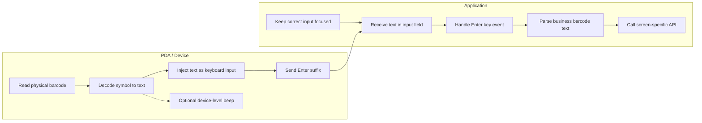
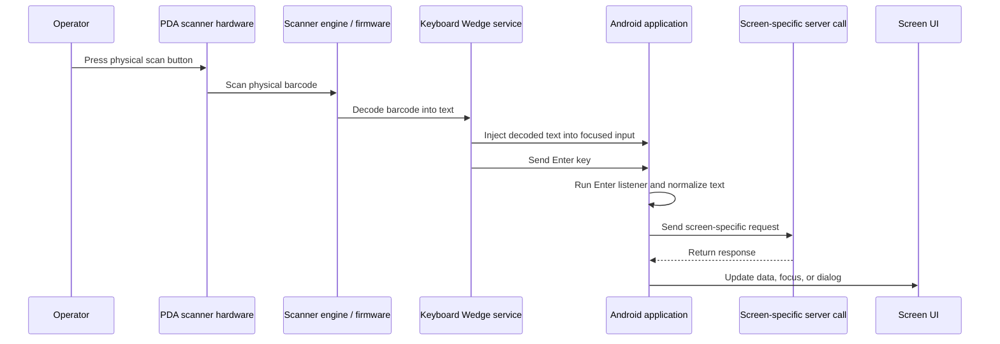
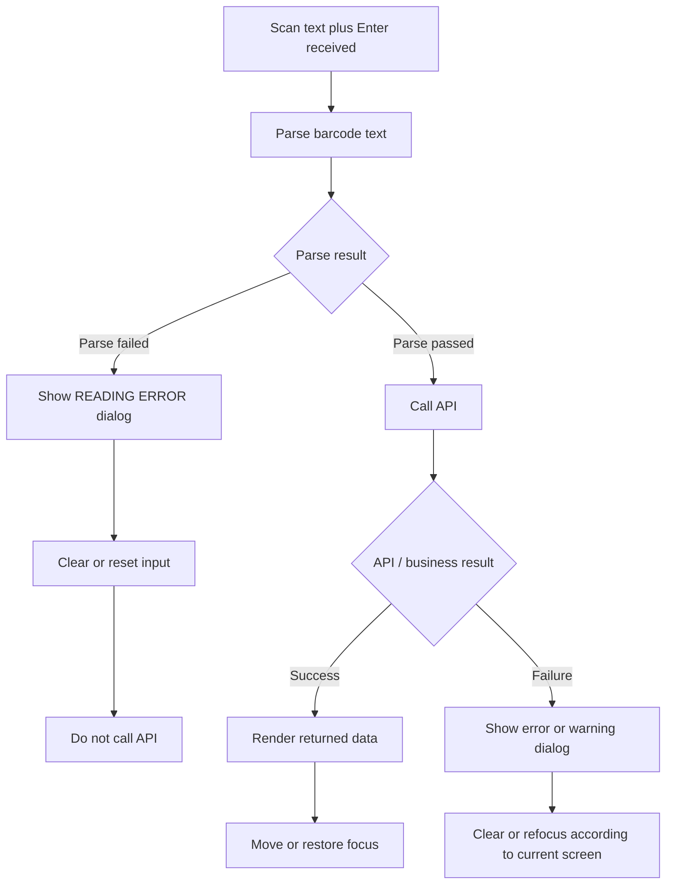
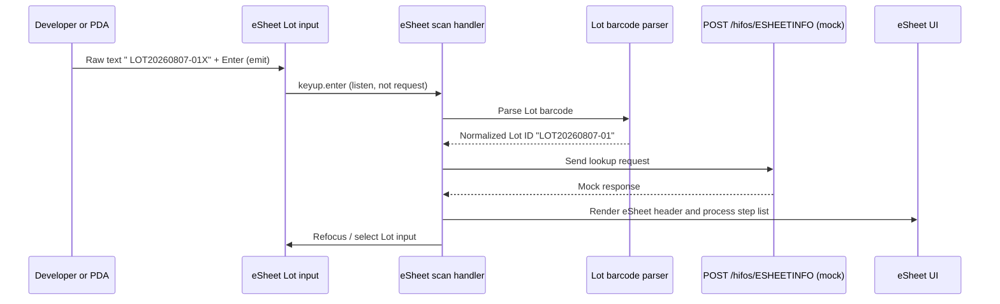

# Technical Analysis — Barcode Reading Mechanism in the HiFOS Mobile PDA App

| Item        | Content                                                                                                                   |
| ----------- | ------------------------------------------------------------------------------------------------------------------------- |
| **Project** | ATSOP26 – SK Key Foundry PDA                                                                                              |
| **Task**    | WBS 2.2 – Study barcode event interface                                                                                   |
| **Authors** | Dong Nguyen Van (DongNV21) – sections 1, 2, 3, 4 \| Tien Do Van (TienDV31) – sections 5, 6, 7, 8                          |
| **Note**    | Requires customer confirmation, as this document is based on the developers' understanding after reading the source code. |
| **Source**  | Customer-provided source code (hifos2, Kotlin)                                                                            |

**Objective:** Read the legacy source code (written in Android/Kotlin) to understand how the current app handles barcode scan events, before re-implementing it in Vue 3.

---

## 1. Barcode Input Mechanism

The app uses only one method to receive barcodes: **Keyboard Wedge**. The scanner acts like a keyboard — when scanning, it types the character string into the currently focused field and then presses Enter. The app catches that Enter to know a scan has completed.

None of the other mechanisms are found in the source:

- No Android scanner Intent.
- No manufacturer SDK/API (Honeywell, Point Mobile, DataWedge, etc.).
- No scanner BroadcastReceiver.
- No Capacitor/Cordova plugin (this is a native Android app).

Example code (`BatchActivity.kt`) — the source itself labels this branch as "Barcode Event":

```kotlin
editMachine.setOnEditorActionListener { v, actionId, event ->
  if (actionId == IME_ACTION_DONE) {        // manual typing
    val check = BarcodeStyle(this).eqpId(editMachine)
    if (check) getMachineInfo()
  } else if (event != null) {               // barcode scan
    if (event.action == ACTION_UP &&
        event.keyCode == KEYCODE_ENTER) {
      val check = BarcodeStyle(this).eqpId(editMachine)
      if (check) getMachineInfo()
    }
  }
}
```

**Note:** What characters the scanner outputs (leading space, trailing character, etc.) is determined by the scanner configuration, which lives outside the source code. The app only receives that character string and processes it.

> **Source references:**
>
> - `app/src/main/java/com/keyfoundry/hifos/view/batch/BatchActivity.kt:83-96` (the "Barcode Event" branch)
> - `app/src/main/res/layout/activity_esheet.xml:90-105` (EditText declaration: `imeOptions="actionDone"`, `inputType="textCapCharacters"`, `selectAllOnFocus`, `singleLine`)

---

## 2. Event Handling Architecture

### 2.1. Where events are captured

Scan events are captured per screen and per input field; there is no global listener for the whole app.

| Screen    | Field(s) with a scan listener    |
| --------- | -------------------------------- |
| eSheet    | editLotNo                        |
| MoveIn    | editIngMachine, editProbeCard    |
| EENAdd    | None (this screen does not scan) |
| LotStatus | editLotNo                        |
| Batch     | editMachine, editLotNo           |

### 2.2. Enter handling, buffering, duplicate prevention

- Manual typing: identified by `actionId == IME_ACTION_DONE`.
- Scan: identified by `event ≠ null, ACTION_UP, KEYCODE_ENTER`.
- The code waits for ACTION_UP, so the key-down event is not processed twice.
- There is no dedicated barcode buffer — the input field (EditText) itself acts as the buffer.
- There is no duplicate-scan prevention or in-flight lock while an API is running. Scanning twice quickly can trigger two overlapping API calls.

### 2.3. Distinguishing manual typing from the scanner

In reality the app cannot truly tell them apart. The code names the two branches "KeyBoard Event" and "Barcode Event", but the Enter from a physical keyboard and from the scanner are identical, and both branches call the same BarcodeStyle validator. There is no device identifier or keystroke-timing analysis.

> **Source references:**
>
> - `ESheetActivity.kt:660-669` (one listener routed by view id)
> - `ESheetActivity.kt:672-686` (the field-local hardware Enter path)
> - `LotStatusActivity.kt:85-90` (Search button allows manual submit, bypassing BarcodeStyle)
> - Repo-wide search: no barcode-related `dispatchKeyEvent`, `onKeyDown`, `onKeyUp`, or global key dispatcher found.

---

## 3. Focus Behavior

Because each field listens individually, the scanner must target a focused field. If no field is focused, the scanned data is not processed — the app has no handling for the no-focus case.

### 3.1. Focus flow per screen

| Screen    | Focus flow                                                                                                                                                                                  |
| --------- | ------------------------------------------------------------------------------------------------------------------------------------------------------------------------------------------- |
| eSheet    | On entry, focuses the Lot field. After an API call (success or failure), it re-focuses and selects all in the Lot field.                                                                    |
| MoveIn    | The Lot is passed in from eSheet. After the Lot is loaded, focus goes to the Equipment field. A valid equipment scan moves focus to the ProbeCard field only when the process is WT or PCM. |
| EENAdd    | No scan flow. The Lot ID is only display text taken from the previous screen.                                                                                                               |
| LotStatus | On entry, focuses the Lot field. Both success and failure re-focus the Lot field.                                                                                                           |
| Batch     | On entry, focuses the Machine field. A successful machine lookup focuses the Lot field. After each Lot lookup, it clears and re-focuses the Lot field.                                      |

**Point to note when re-implementing in Vue:** the focus flow must match the original exactly. For example, Batch is Machine → Lot → Lot; MoveIn is Machine → ProbeCard but only when the process is WT/PCM. If the flow is wrong, scanned data will land in the wrong field.

> **Source references:**
>
> - `MoveInActivity.kt:163-186` (focus moves to ProbeCard only when `m_processType == "WT" || "PCM"`)
> - `BatchActivity.kt:299-309` (`activityInit()` focuses the Machine field first)
> - `BatchActivity.kt:369-390` (focuses the Lot field after a valid equipment lookup)

---

## 4. Barcode String Processing Logic (BarcodeStyle class)

This is the most important part. BarcodeStyle has exactly three methods, each handling one barcode type. It does not recognize the barcode symbology (QR, Code128, etc.); it only checks the framing (prefix and trailing character) of the received string.

### 4.1. lotId() — Lot code

Expected raw string: `1 space + [optional $] + payload + 1 trailing character`

- Must start with one space. If not, it shows a READING ERROR popup and clears the field.
- Removes the first space.
- If the remainder starts with $, it removes $ and trims the leading whitespace.
- Always removes the final character (if any remains).
- Writes the normalized value back to the field, returning true if the string is non-empty.

Example: the raw string `" WP00001?"` becomes `"WP00001"` after processing.

### 4.2. eqpId() — Equipment code

Expected raw string: `"EQP-" + payload + 1 trailing character`

- Must have the prefix EQP-. If not, it shows a READING ERROR popup and clears the field.
- Removes the first EQP- prefix.
- Always removes the final character (if any remains).

### 4.3. ProbeCardId() — Probe Card code

Expected raw string: `1 space + payload + 1 trailing character`

- Must have one leading space. If not, it shows a READING ERROR popup and clears the field.
- Removes that space, then removes the final character.
- The source has a comment questioning whether removing the last character is correct; this needs to be confirmed with the customer.

### 4.4. What BarcodeStyle does NOT do

- No maximum/minimum length limit.
- No regex or character whitelist.
- No checksum validation.
- Uppercasing: the screens use `InputFilter.AllCaps()` to force uppercase; BarcodeStyle itself does not change case.
- BarcodeStyle never calls an API by itself. It only returns true/false; the screen decides the next API call (e.g., eSheet calls searchData, Batch calls getMachineInfo).

### 4.5. Risk points to keep in mind

These are noted so we handle them correctly in Vue and do not blindly copy the legacy behavior:

- The always-remove-final-character logic: in Android the final character is part of the field value, so it must be removed. But on the web (WebView) the Enter key is usually NOT part of the field value, so copying this verbatim could delete a real character of the code. This must be verified by scanning on a real PM95 device.
- A prefix-only string (e.g., just `" "` or `"EQP-"`) normalizes to empty and fails silently, without a popup.
- The final character is never checked for what it actually is — it is always removed.
- Uppercasing should be done on the submitted value, not just via CSS, because CSS does not change the value sent.

> **Source references:**
>
> - `BarcodeStyle.kt:17-31, 33-38` (`lotId()` method)
> - `BarcodeStyle.kt:45-62` (`eqpId()` method)
> - `BarcodeStyle.kt:69-83` (`ProbeCardId()` method)
> - `BarcodeStyle.kt:10-13, 41, 65` (class and the three method declarations)

---

## 5. Hardware Integration

### 5.1. Current Integration

The source code does not show direct scanner hardware integration. The barcode flow is handled as keyboard input into focused fields.

| Integration area             | Finding                     | Meaning                                                                                  |
| ---------------------------- | --------------------------- | ---------------------------------------------------------------------------------------- |
| Capacitor plugin             | Not implemented             | The current application is native Android, not a Capacitor scanner integration.          |
| Camera scanning              | Not implemented             | The app does not open an in-app camera scanner screen.                                   |
| Scanner manufacturer SDK     | Not implemented             | No direct Zebra, Honeywell, Point Mobile, Urovo, or similar scanner SDK usage was found. |
| Scanner broadcast receiver   | Not implemented             | The app does not receive barcode values through a scanner broadcast intent.              |
| Hardware scan button handler | Not implemented in app code | The physical scan button is handled by the PDA/scanner service, not by the app.          |
| Keyboard Wedge behavior      | Implemented indirectly      | Decoded barcode text is received through the focused input field.                        |

### 5.2. Hardware Responsibility Boundary

The application and the PDA environment have separate responsibilities.

| Application Responsibility  | PDA / Device Responsibility   |
| --------------------------- | ----------------------------- |
| Keep correct input focused  | Read physical barcode         |
| Receive text in input field | Decode symbol to text         |
| Handle Enter key event      | Inject text as keyboard input |
| Parse business barcode text | Send Enter suffix             |
| Call screen-specific API    | Optional device-level beep    |



The exact scanner engine model cannot be identified from the application source. In a real PDA deployment, this is normally a built-in 1D laser scanner or 2D imager scanner module. The current app only depends on the decoded text reaching the focused input field.

### 5.3. Runtime Hardware Flow

Operator presses the physical scan button → PDA scanner hardware scans the physical barcode → scanner engine/firmware decodes it into text → the Keyboard Wedge service injects the text into the focused input and sends the Enter key → the Android application runs the Enter listener and normalizes the text → sends the screen-specific request → receives the response → updates data, focus, or dialog.



### 5.4. Components Involved

| Component                   | Role                                                                   |
| --------------------------- | ---------------------------------------------------------------------- |
| PDA scanner hardware        | Reads the physical barcode.                                            |
| PDA scanner engine          | Decodes the barcode image/symbol into text.                            |
| Keyboard Wedge service      | Sends decoded text to Android as keyboard input.                       |
| Focused input field         | Receives the decoded text.                                             |
| Screen-level Enter listener | Detects completion of the scan input.                                  |
| Barcode parser              | Validates and normalizes the decoded text.                             |
| API sender                  | Sends a request to the server endpoint selected by the current screen. |

> **Source references:**
>
> - `app/build.gradle:80-93` (dependencies are only AndroidX/Room/Retrofit/Gson/OkHttp/nanohttpd; no manufacturer scanner library)
> - `app/src/main/AndroidManifest.xml:238-246` (the receiver is UDP-related, no scanner intent filter)
> - `PatchActivity.kt:66-77` (the other receiver is an APK-download progress receiver, not a scanner)
> - `RetrofitSyncService.kt:34-41` (`@POST("/hifos/{messageName}")`)

---

## 6. Feedback Mechanism

### 6.1. Feedback Layers

The source code shows feedback in the application layer after input parsing or server/business validation. It does not show a generic app-controlled beep or vibration for every successful scan.



### 6.2. Successful Parse and API Success

When the barcode text is parsed successfully, the application proceeds to the current screen's lookup or validation API. Observed behavior includes:

| Screen behavior           | Feedback shown to user                                                  |
| ------------------------- | ----------------------------------------------------------------------- |
| Lookup returns data       | The screen renders returned values, grids, or detail fields.            |
| Equipment lookup succeeds | The equipment value is normalized and the next field may receive focus. |
| Batch lot lookup succeeds | The lot can be added to the grid after screen-level checks.             |
| Lot inquiry succeeds      | Lot information is displayed and the lot field is focused again.        |

There is no generic application-level success beep, success vibration, or success toast in the scanner flow found in the current implementation.

### 6.3. Parse Failure

Parse failure happens before any server request is sent. Implemented parse failure behavior:

| Barcode input type | Failure condition                                    | Implemented feedback                |
| ------------------ | ---------------------------------------------------- | ----------------------------------- |
| Lot ID             | Input does not start with the expected leading space | READING ERROR popup, input cleared. |
| Equipment ID       | Input does not start with EQP-                       | READING ERROR popup, input cleared. |
| ProbeCard ID       | Input does not start with the expected leading space | READING ERROR popup, input cleared. |

For these failures, the API call is skipped.

### 6.4. API or Business Failure

If parsing succeeds but the server response or screen-level business validation fails, the application shows screen-specific feedback. Implemented behavior includes:

| Failure area                  | Implemented feedback                                         |
| ----------------------------- | ------------------------------------------------------------ |
| Server/API failure            | Error dialog with the returned or extracted message.         |
| Business warning or interlock | Warning or alarm dialog depending on the screen flow.        |
| Move-related alarm dialogs    | Some paths use vibration and the default notification sound. |
| Batch lookup failure          | Error dialog, clear/refocus the relevant scan field.         |
| Lot lookup failure            | Error dialog or cleared result area depending on the screen. |

> **Source references:**
>
> - `BatchActivity.kt:814-832` (on success: update grid, clear + refocus the Lot field)
> - `OkDialogFragment.kt:53-69` (the READING ERROR dialog is visual only, no sound/vibration)
> - `OkDailogAlram.kt:51-58` (business alarm: vibrate 1 second + play the default notification tone)

---

## 7. Supported Barcode Types

### 7.1. Physical Barcode Symbologies

The source code does not configure or restrict physical barcode symbologies. Therefore, support for physical barcode types is controlled by the PDA scanner hardware and scanner profile, not by the application source code.

### 7.2. Application-Level Barcode Payloads

The application supports decoded text formats, not physical barcode symbology types. Once the PDA has decoded the barcode into text, the app validates the text according to the expected business input type.

| Business payload | Expected decoded text pattern                            | App normalization behavior                                            |
| ---------------- | -------------------------------------------------------- | --------------------------------------------------------------------- |
| Lot ID           | Leading space, optional `$`, payload, trailing character | Removes leading space, removes optional `$`, removes final character. |
| Equipment ID     | `EQP-`, payload, trailing character                      | Removes `EQP-`, removes final character.                              |
| ProbeCard ID     | Leading space, payload, trailing character               | Removes leading space, removes final character.                       |
| PR barcode       | Screen-specific PR text                                  | Uses screen-specific length and substring validation.                 |
| Reticle/Mask tag | Screen-specific text                                     | Removes the final character before lookup.                            |

Examples:

| Decoded text received in input | Business parser | Normalized value |
| ------------------------------ | --------------- | ---------------- |
| ` LOT20260807-01X`             | Lot ID          | `LOT20260807-01` |
| `$LOT20260807-01X`             | Lot ID          | `LOT20260807-01` |
| `EQP-FUR-01X`                  | Equipment ID    | `FUR-01`         |
| `PC-FAB1-001X`                 | ProbeCard ID    | `PC-FAB1-001`    |

The final-character removal is part of the current implementation. It should be reproduced carefully in the FE simulation only when simulating the same raw keyboard-wedge input format.

> **Source references:**
>
> - `BarcodeStyle.kt:10-13, 41, 65` (all three parser methods — evidence the app only processes payload text and does not configure symbology)

---

## 8. FE and Mock Server Simulation

### 8.1. Simulation Goal

Because the real server API is not available, the FE should simulate the same practical flow:

1. A scan input receives raw barcode text.
2. Enter triggers the same handler that real PDA scanning would trigger.
3. The FE parser normalizes the text.
4. The current screen and focused field determine which API to call.
5. The FE calls a mock server endpoint.
6. The mock server returns source-aligned POC response data.
7. The FE updates the screen according to the response.

### 8.2. Simulation Model: LISTEN for data, do NOT request the scanner

**Key point to get right (clarified per review feedback):** our web app does **not** actively send a request to the scanner to "ask it to read" and then wait for a response. It is the opposite — after scanning, the scanner **pushes** the data (text + Enter) into the currently focused field on its own. The app only **listens** to that event, exactly like the legacy Android code uses `setOnEditorActionListener` to catch `IME_ACTION_DONE` / `KEYCODE_ENTER`. This is an **event-driven** model, not request–response.

Mapping of the "listen" mechanism from legacy Android to the new Vue:

| Android (legacy)                        | Vue (new)                                                     | Meaning                                                                    |
| --------------------------------------- | ------------------------------------------------------------- | -------------------------------------------------------------------------- |
| `setOnEditorActionListener` on EditText | `@keyup.enter` (or a `keydown`/`keyup` listener) on `q-input` | Both "listen" for the scan-completion signal; neither queries the scanner. |
| `actionId == IME_ACTION_DONE`           | `keyup.enter` event from the focused field                    | Signal that "input/scan has completed".                                    |
| `event.keyCode == KEYCODE_ENTER`        | `event.key === 'Enter'`                                       | Both detect the Enter terminator.                                          |

**How to simulate by emitting a similar event.** Since there is no real scanner during development, we need a way to "fake" the scanner pushing data. The essence is: **set the raw text into the field, then dispatch/emit an Enter event** so the screen's real handler runs — just like a real scan.

Example of a function that simulates one scan (dispatch an Enter KeyboardEvent into the focused input):

```ts
// useScannerSimulator.ts — dev/test only, not for production
function simulateScan(inputEl: HTMLInputElement, rawText: string) {
  // 1. The scanner "types" the raw text into the field
  //    (including the leading space / trailing char like a real wedge)
  inputEl.focus();
  inputEl.value = rawText;
  inputEl.dispatchEvent(new Event("input", { bubbles: true })); // update v-model

  // 2. The scanner "presses Enter" -> emit an Enter event to trigger the real handler
  const enter = new KeyboardEvent("keyup", {
    key: "Enter",
    code: "Enter",
    keyCode: 13,
    bubbles: true,
  });
  inputEl.dispatchEvent(enter);
}

// Usage: simulate a Lot scan on the eSheet screen
simulateScan(lotInputRef.value, " LOT20260807-01X");
```

With this approach, **the same handler** (`@keyup.enter`) handles both cases: a real scan from the PM95 device and a simulated scan during development. That handler calls the barcode parser to normalize the value, and only then calls the mock server. In other words, the mock lives only at the **API/response** layer, while the **scan-event intake** goes through a single shared path, preserving the true "listen data" nature.

Overall simulation flow:

```mermaid
flowchart LR
  A[Vue Screen: eSheet, Batch, MoveIn, LotStatus] --> B[Focused Scan Input receives raw text]
  B -->|Enter emit| C[Scan Handler: screen + field logic]
  C --> D[Barcode Parser: Lot / EQP / ProbeCard]
  D --> E[API Route Mapping: screen + field]
  E --> F[FE API Client]
  F --> G[Mock HiFOS Server]
  G --> H[Fixture Response]
  H --> I[Vue State / UI Update]
```



**Example: eSheet Scan Simulation**

Raw text `" LOT20260807-01X"` + Enter → a `keyup.enter` event is emitted → the handler catches it (like `IME_ACTION_DONE` on Android) → parse Lot barcode → normalized Lot ID `"LOT20260807-01"` → send lookup request to the mock → mock response → render the eSheet header and process step list → refocus/select the Lot input.



Request:

```json
{
  "lotId": "LOT20260807-01",
  "facility": "FAB1",
  "historyCount": "0",
  "forwardCount": "0"
}
```

Response:

```json
{
  "lotId": "LOT20260807-01",
  "photoJobCode": "JOB-01",
  "priority": "NORMAL",
  "status": "WAIT",
  "productQuantity": 25,
  "product": "KEY-018-HV",
  "factoryName": "FAB1",
  "processFlowName": "MAIN_FLOW_01",
  "esheetItems": [
    {
      "operation": "1000",
      "subOperation": "010",
      "processStep": "DIFFUSION OXY",
      "commentCnt": 0,
      "inQty": 25,
      "outQty": 25,
      "spec": "OXY THICKNESS 100A",
      "recipe": "RECIPE_OXY_01",
      "eqpGroup": "FURNACE_BAY_01",
      "isCurrent": "Y",
      "realEqpId": "EQP-FUR-01",
      "realRecipe": "RECIPE_OXY_01"
    }
  ]
}
```

> **Source references (per-screen API call sequence):**
>
> - `ESheetActivity.kt:689-710` (`searchData` → `esheetinfo`)
> - `MoveInActivity.kt:1455-1486` (`getMCFDCMachineinfo` → `mcfdceqpinfo`)
> - `EENAddActivity.kt:62-79` (receives LOTID and context via Intent, no scanning)
> - `LotStatusActivity.kt:161-179` (`searchData` → `lotinfo`)
> - `BatchActivity.kt:361-381` (`getMachineInfo` → `realeqpid`)
> - `MessageName.kt:12-22, 50-59, 145-149, 179` (API names: `lotinfo`, `blotinfo`, `esheetinfo`, `recipeinfo`, `realeqpid`, `eqpinfo`, `mcfdceqpinfo`, `probecardinfo`, `probecardvalue`, `inserteen`)
