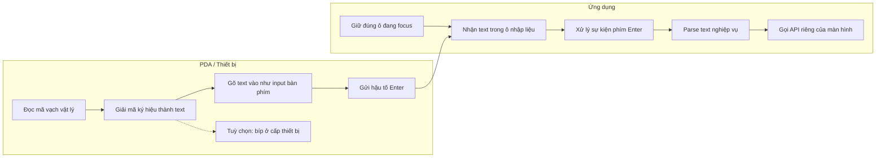
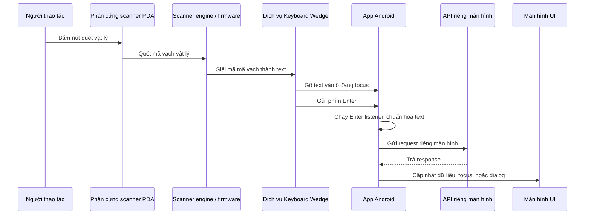
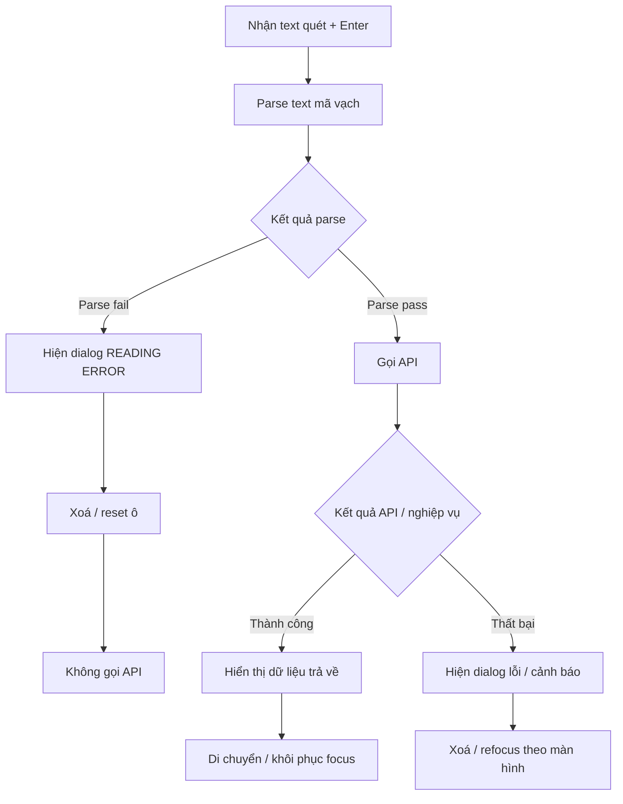
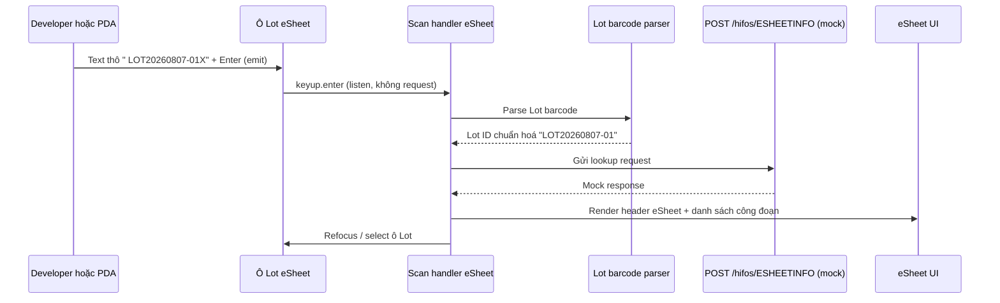

# Tài liệu phân tích kỹ thuật — Cơ chế đọc mã vạch (barcode) trong app HiFOS Mobile PDA

| Mục            | Nội dung                                                                                         |
| -------------- | ------------------------------------------------------------------------------------------------ |
| **Dự án**      | ATSOP26 – SK Key Foundry PDA                                                                     |
| **Task**       | WBS 2.2 – Study barcode event interface                                                          |
| **Người viết** | Dong Nguyen Van (DongNV21) – phần 1, 2, 3, 4 \| Tien Do Van (TienDV31) – phần 5, 6, 7, 8         |
| **Ghi chú**    | Cần khách hàng confirm vì tài liệu này dựa trên hiểu biết của developer sau khi đọc source code. |
| **Nguồn**      | Source code khách cung cấp (hifos2, Kotlin)                                                      |

**Mục tiêu:** đọc source code cũ (viết bằng Android/Kotlin) để hiểu app hiện tại xử lý sự kiện quét mã vạch như thế nào, trước khi làm lại bằng Vue 3.

---

## 1. Cơ chế nhận mã vạch

App chỉ dùng một cách duy nhất để nhận mã vạch: **Keyboard Wedge**. Nghĩa là máy quét hoạt động như một cái bàn phím — khi quét, nó gõ dãy ký tự vào ô đang được chọn rồi tự bấm Enter. App bắt phím Enter đó để biết vừa quét xong.

Các cách khác đều không có trong source:

- Không dùng Android scanner Intent.
- Không dùng SDK/API của hãng (Honeywell, Point Mobile, DataWedge...).
- Không dùng BroadcastReceiver cho máy quét.
- Không có Capacitor/Cordova plugin (đây là app Android thuần).

Đoạn code minh hoạ (`BatchActivity.kt`) — bản thân source cũng ghi chú nhánh này là "Barcode Event":

```kotlin
editMachine.setOnEditorActionListener { v, actionId, event ->
  if (actionId == IME_ACTION_DONE) {        // gõ tay
    val check = BarcodeStyle(this).eqpId(editMachine)
    if (check) getMachineInfo()
  } else if (event != null) {               // quét mã
    if (event.action == ACTION_UP &&
        event.keyCode == KEYCODE_ENTER) {
      val check = BarcodeStyle(this).eqpId(editMachine)
      if (check) getMachineInfo()
    }
  }
}
```

**Lưu ý:** việc máy quét xuất ra ký tự gì (dấu cách đầu, ký tự cuối...) là do cấu hình của máy quét, nằm ngoài source code. App chỉ nhận chuỗi ký tự đó rồi xử lý.

> **Nguồn tham chiếu:**
>
> - `app/src/main/java/com/keyfoundry/hifos/view/batch/BatchActivity.kt:83-96` (nhánh "Barcode Event")
> - `app/src/main/res/layout/activity_esheet.xml:90-105` (khai báo EditText: `imeOptions="actionDone"`, `inputType="textCapCharacters"`, `selectAllOnFocus`, `singleLine`)

---

## 2. Kiến trúc xử lý sự kiện

### 2.1. Bắt sự kiện ở đâu

Sự kiện quét được bắt theo từng màn hình và từng ô nhập liệu, không có bộ lắng nghe chung cho cả app.

| Màn hình  | Ô có gắn listener quét        |
| --------- | ----------------------------- |
| eSheet    | editLotNo                     |
| MoveIn    | editIngMachine, editProbeCard |
| EENAdd    | Không có (màn này không quét) |
| LotStatus | editLotNo                     |
| Batch     | editMachine, editLotNo        |

### 2.2. Xử lý Enter, buffer, chống trùng

- Gõ tay: nhận biết qua `actionId == IME_ACTION_DONE`.
- Quét: nhận biết qua `event ≠ null, ACTION_UP, KEYCODE_ENTER`.
- Code chờ ACTION_UP nên sự kiện nhấn phím xuống (key-down) không bị xử lý lặp.
- Không có buffer riêng cho mã vạch — chính ô nhập liệu (EditText) đóng vai trò buffer.
- Không có cơ chế chống quét trùng hay khoá khi đang gọi API. Quét nhanh 2 lần có thể tạo 2 lần gọi API chồng nhau.

### 2.3. Phân biệt gõ tay và máy quét

Thực ra app không phân biệt được thật sự. Code đặt tên 2 nhánh là "KeyBoard Event" và "Barcode Event", nhưng phím Enter của bàn phím vật lý và của máy quét là giống hệt nhau, và cả 2 nhánh đều gọi cùng một bộ kiểm tra BarcodeStyle. Không có mã định danh thiết bị hay phân tích thời gian gõ.

> **Nguồn tham chiếu:**
>
> - `ESheetActivity.kt:660-669` (một listener định tuyến theo view id)
> - `ESheetActivity.kt:672-686` (nhánh phím Enter phần cứng, xử lý cục bộ theo ô)
> - `LotStatusActivity.kt:85-90` (nút Search cho phép submit thủ công, bỏ qua BarcodeStyle)
> - Tìm toàn repo: không có `dispatchKeyEvent`, `onKeyDown`, `onKeyUp` hay bộ dispatch phím toàn cục nào liên quan barcode.

---

## 3. Hành vi focus

Vì mỗi ô tự lắng nghe sự kiện, nên máy quét bắt buộc phải trỏ vào một ô đang được focus. Nếu không có ô nào được focus thì dữ liệu quét sẽ không được xử lý — app không có cơ chế xử lý khi mất focus.

### 3.1. Luồng focus theo từng màn hình

| Màn hình  | Luồng focus                                                                                                                              |
| --------- | ---------------------------------------------------------------------------------------------------------------------------------------- |
| eSheet    | Vào màn focus ô Lot. Sau khi gọi API (thành công hoặc lỗi) đều focus lại và bôi đen ô Lot.                                               |
| MoveIn    | Lot truyền từ eSheet sang. Sau khi nạp Lot thì focus ô Máy. Quét máy hợp lệ mà process là WT hoặc PCM thì chuyển focus sang ô ProbeCard. |
| EENAdd    | Không có luồng quét. Lot ID chỉ là chữ hiển thị, lấy từ màn trước.                                                                       |
| LotStatus | Vào màn focus ô Lot. Thành công hay lỗi đều focus lại ô Lot.                                                                             |
| Batch     | Vào màn focus ô Máy. Tra máy thành công thì focus ô Lot. Mỗi lần tra Lot xong thì xoá và focus lại ô Lot.                                |

**Điểm cần chú ý khi làm lại bằng Vue:** phải giữ đúng luồng focus như bản gốc. Ví dụ Batch là Máy rồi tới Lot rồi Lot tiếp; MoveIn là Máy rồi ProbeCard nhưng chỉ khi process là WT/PCM. Nếu làm sai luồng, dữ liệu quét sẽ rơi vào nhầm ô.

> **Nguồn tham chiếu:**
>
> - `MoveInActivity.kt:163-186` (chỉ chuyển focus sang ProbeCard khi `m_processType == "WT" || "PCM"`)
> - `BatchActivity.kt:299-309` (`activityInit()` focus ô Máy trước)
> - `BatchActivity.kt:369-390` (focus ô Lot sau khi tra thiết bị hợp lệ)

---

## 4. Logic xử lý chuỗi mã (class BarcodeStyle)

Đây là phần quan trọng nhất. BarcodeStyle có đúng 3 hàm, mỗi hàm xử lý một loại mã. Nó không nhận biết loại mã vạch (QR, Code128...), chỉ kiểm tra khung (prefix và ký tự cuối) của chuỗi ký tự nhận được.

### 4.1. lotId() — mã Lot

Chuỗi thô mong đợi: `1 dấu cách + [tuỳ chọn $] + nội dung + 1 ký tự cuối`

- Bắt buộc bắt đầu bằng 1 dấu cách. Nếu không có thì hiện popup READING ERROR và xoá ô.
- Bỏ dấu cách đầu tiên.
- Nếu phần còn lại bắt đầu bằng $ thì bỏ $ và cắt khoảng trắng đầu.
- Luôn cắt bỏ ký tự cuối cùng (nếu còn ký tự).
- Ghi giá trị đã làm sạch trở lại ô, trả về true nếu chuỗi khác rỗng.

Ví dụ: chuỗi thô `" WP00001?"` sau khi xử lý sẽ thành `"WP00001"`.

### 4.2. eqpId() — mã Thiết bị

Chuỗi thô mong đợi: `"EQP-" + nội dung + 1 ký tự cuối`

- Bắt buộc có tiền tố EQP-. Nếu không có thì hiện popup READING ERROR và xoá ô.
- Bỏ tiền tố EQP- đầu tiên.
- Luôn cắt ký tự cuối cùng (nếu còn ký tự).

### 4.3. ProbeCardId() — mã Probe Card

Chuỗi thô mong đợi: `1 dấu cách + nội dung + 1 ký tự cuối`

- Bắt buộc có 1 dấu cách đầu. Nếu không có thì hiện popup READING ERROR và xoá ô.
- Bỏ dấu cách đó rồi cắt ký tự cuối.
- Trong source có comment tự hỏi việc cắt ký tự cuối có đúng không, cần xác nhận lại với khách.

### 4.4. Những thứ không có trong BarcodeStyle

- Không giới hạn độ dài tối đa/tối thiểu.
- Không có regex hay whitelist ký tự.
- Không kiểm tra checksum.
- Chữ hoa: các màn hình dùng `InputFilter.AllCaps()` để ép hoa, chứ BarcodeStyle không tự đổi hoa/thường.
- BarcodeStyle không tự gọi API. Nó chỉ trả về true/false; màn hình mới quyết định gọi API tiếp theo (ví dụ eSheet gọi searchData, Batch gọi getMachineInfo).

### 4.5. Một vài điểm rủi ro cần lưu ý

Mấy điểm này ghi lại để khi làm bằng Vue mình xử lý cho đúng, không copy y nguyên bản cũ:

- Việc luôn cắt ký tự cuối: trong Android ký tự cuối nằm trong giá trị ô nên phải cắt. Nhưng trên web (WebView) phím Enter thường không nằm trong giá trị ô, nên nếu cắt y nguyên có thể mất 1 ký tự thật của mã. Cần quét thử trên máy PM95 thật để kiểm tra.
- Chuỗi chỉ có tiền tố (ví dụ chỉ có `" "` hoặc `"EQP-"`) sẽ trả về rỗng và fail âm thầm, không hiện popup.
- Ký tự cuối không bao giờ được kiểm tra là ký tự gì, cứ cắt là cắt.
- Ép chữ hoa nên làm ở giá trị submit, không nên chỉ dùng CSS vì CSS không đổi giá trị gửi đi.

> **Nguồn tham chiếu:**
>
> - `BarcodeStyle.kt:17-31, 33-38` (hàm `lotId()`)
> - `BarcodeStyle.kt:45-62` (hàm `eqpId()`)
> - `BarcodeStyle.kt:69-83` (hàm `ProbeCardId()`)
> - `BarcodeStyle.kt:10-13, 41, 65` (khai báo class và 3 hàm)

---

## 5. Tích hợp phần cứng (Hardware Integration)

### 5.1. Tình trạng tích hợp hiện tại

Source code không thể hiện việc tích hợp trực tiếp với phần cứng máy quét. Luồng barcode được xử lý như dữ liệu bàn phím gõ vào ô đang focus.

| Hạng mục tích hợp         | Kết quả                 | Ý nghĩa                                                              |
| ------------------------- | ----------------------- | -------------------------------------------------------------------- |
| Capacitor plugin          | Không có                | App hiện tại là Android thuần, không tích hợp scanner qua Capacitor. |
| Camera scanning           | Không có                | App không mở màn hình quét bằng camera trong app.                    |
| SDK hãng máy quét         | Không có                | Không tìm thấy dùng SDK của Zebra, Honeywell, Point Mobile, Urovo... |
| Scanner BroadcastReceiver | Không có                | App không nhận giá trị barcode qua broadcast intent của máy quét.    |
| Xử lý nút quét cứng       | Không có trong code app | Nút quét vật lý do dịch vụ PDA/scanner xử lý, không phải app.        |
| Hành vi Keyboard Wedge    | Có (gián tiếp)          | Text mã vạch đã giải mã được nhận qua ô nhập liệu đang focus.        |

### 5.2. Ranh giới trách nhiệm phần cứng

App và môi trường PDA có trách nhiệm tách biệt nhau.

| Trách nhiệm của App         | Trách nhiệm của PDA / Thiết bị         |
| --------------------------- | -------------------------------------- |
| Giữ đúng ô đang được focus  | Đọc mã vạch vật lý                     |
| Nhận text trong ô nhập liệu | Giải mã ký hiệu thành text             |
| Xử lý sự kiện phím Enter    | Gõ text vào như input bàn phím         |
| Parse text nghiệp vụ của mã | Gửi hậu tố Enter                       |
| Gọi API riêng của từng màn  | Tuỳ chọn phát tiếng bíp ở cấp thiết bị |



Không thể xác định chính xác model scanner engine từ source app. Trong triển khai PDA thực tế, đây thường là module quét laser 1D hoặc imager 2D tích hợp sẵn. App hiện tại chỉ phụ thuộc vào việc text đã giải mã đến được ô nhập liệu đang focus.

### 5.3. Luồng phần cứng lúc chạy (Runtime Flow)

Người thao tác bấm nút quét vật lý → phần cứng PDA quét mã vạch → scanner engine/firmware giải mã thành text → dịch vụ Keyboard Wedge gõ text vào ô đang focus + gửi phím Enter → App Android chạy Enter listener và chuẩn hoá text → gửi request riêng của màn hình → nhận response → cập nhật dữ liệu, focus, hoặc dialog.



### 5.4. Các thành phần tham gia

| Thành phần                  | Vai trò                                                          |
| --------------------------- | ---------------------------------------------------------------- |
| Phần cứng scanner PDA       | Đọc mã vạch vật lý.                                              |
| Scanner engine PDA          | Giải mã hình ảnh/ký hiệu mã vạch thành text.                     |
| Dịch vụ Keyboard Wedge      | Gửi text đã giải mã vào Android như input bàn phím.              |
| Ô nhập liệu đang focus      | Nhận text đã giải mã.                                            |
| Enter listener cấp màn hình | Phát hiện kết thúc input quét.                                   |
| Barcode parser              | Kiểm tra và chuẩn hoá text đã giải mã.                           |
| API sender                  | Gửi request tới endpoint server tương ứng với màn hình hiện tại. |

> **Nguồn tham chiếu:**
>
> - `app/build.gradle:80-93` (dependencies chỉ có AndroidX/Room/Retrofit/Gson/OkHttp/nanohttpd; không có thư viện scanner của hãng)
> - `app/src/main/AndroidManifest.xml:238-246` (receiver là UDP, không có scanner intent filter)
> - `PatchActivity.kt:66-77` (receiver còn lại là tải APK, không phải scanner)
> - `RetrofitSyncService.kt:34-41` (`@POST("/hifos/{messageName}")`)

---

## 6. Cơ chế phản hồi (Feedback Mechanism)

### 6.1. Các lớp phản hồi

Source code thể hiện phản hồi ở lớp ứng dụng sau khi parse input hoặc sau khi server/nghiệp vụ kiểm tra. App **không** có tiếng bíp hay rung app-level chung cho mọi lần quét thành công.



### 6.2. Parse thành công và API thành công

Khi text mã vạch parse thành công, app đi tiếp tới API tra cứu/kiểm tra của màn hình hiện tại. Các hành vi quan sát được:

| Hành vi màn hình               | Phản hồi cho người dùng                                          |
| ------------------------------ | ---------------------------------------------------------------- |
| Tra cứu trả về dữ liệu         | Màn hình hiển thị giá trị, lưới, hoặc trường chi tiết.           |
| Tra cứu thiết bị thành công    | Giá trị thiết bị được chuẩn hoá và ô kế tiếp có thể nhận focus.  |
| Tra Lot trong Batch thành công | Lot có thể được thêm vào lưới sau khi qua kiểm tra cấp màn hình. |
| Tra Lot thành công             | Thông tin Lot hiển thị và ô Lot được focus lại.                  |

Không có tiếng bíp / rung / toast báo thành công ở cấp ứng dụng trong luồng quét của bản hiện tại.

### 6.3. Parse thất bại

Parse thất bại xảy ra trước khi gửi bất kỳ request nào lên server. Hành vi đã cài đặt:

| Loại input barcode | Điều kiện thất bại                         | Phản hồi đã cài đặt         |
| ------------------ | ------------------------------------------ | --------------------------- |
| Lot ID             | Input không bắt đầu bằng dấu cách mong đợi | Popup READING ERROR, xoá ô. |
| Equipment ID       | Input không bắt đầu bằng EQP-              | Popup READING ERROR, xoá ô. |
| ProbeCard ID       | Input không bắt đầu bằng dấu cách mong đợi | Popup READING ERROR, xoá ô. |

Với các thất bại này, lời gọi API bị bỏ qua.

### 6.4. Thất bại API hoặc nghiệp vụ

Nếu parse thành công nhưng response server hoặc kiểm tra nghiệp vụ cấp màn hình thất bại, app hiện phản hồi riêng theo màn hình:

| Vùng thất bại                  | Phản hồi đã cài đặt                             |
| ------------------------------ | ----------------------------------------------- |
| Lỗi Server/API                 | Dialog lỗi kèm message trả về hoặc trích xuất.  |
| Cảnh báo nghiệp vụ / interlock | Dialog cảnh báo hoặc alarm tuỳ luồng màn hình.  |
| Alarm liên quan MoveIn         | Một số luồng dùng rung + âm thông báo mặc định. |
| Tra Batch thất bại             | Dialog lỗi, xoá/refocus ô quét liên quan.       |
| Tra Lot thất bại               | Dialog lỗi hoặc xoá vùng kết quả tuỳ màn hình.  |

> **Nguồn tham chiếu:**
>
> - `BatchActivity.kt:814-832` (thành công: cập nhật grid, xoá + refocus ô Lot)
> - `OkDialogFragment.kt:53-69` (dialog READING ERROR chỉ có hình ảnh, không âm thanh/rung)
> - `OkDailogAlram.kt:51-58` (alarm nghiệp vụ: rung 1 giây + phát nhạc thông báo mặc định)

---

## 7. Loại mã vạch được hỗ trợ (Supported Barcode Types)

### 7.1. Symbology mã vạch vật lý

Source code không cấu hình hay giới hạn symbology mã vạch vật lý. Do đó việc hỗ trợ loại mã vạch vật lý do phần cứng scanner PDA và scanner profile quyết định, không phải source code app.

### 7.2. Payload mã vạch cấp ứng dụng

App hỗ trợ các định dạng text đã giải mã, không phải loại symbology vật lý. Sau khi PDA giải mã mã vạch thành text, app kiểm tra text đó theo loại input nghiệp vụ mong đợi.

| Payload nghiệp vụ | Mẫu text đã giải mã mong đợi                     | Cách app chuẩn hoá                                       |
| ----------------- | ------------------------------------------------ | -------------------------------------------------------- |
| Lot ID            | Dấu cách đầu, tuỳ chọn `$`, nội dung, ký tự cuối | Bỏ dấu cách đầu, bỏ `$` tuỳ chọn, bỏ ký tự cuối.         |
| Equipment ID      | `EQP-`, nội dung, ký tự cuối                     | Bỏ `EQP-`, bỏ ký tự cuối.                                |
| ProbeCard ID      | Dấu cách đầu, nội dung, ký tự cuối               | Bỏ dấu cách đầu, bỏ ký tự cuối.                          |
| PR barcode        | Text PR riêng theo màn hình                      | Dùng validation độ dài và substring riêng theo màn hình. |
| Reticle/Mask tag  | Text riêng theo màn hình                         | Bỏ ký tự cuối trước khi tra cứu.                         |

Ví dụ:

| Text đã giải mã nhận vào ô | Parser nghiệp vụ | Giá trị đã chuẩn hoá |
| -------------------------- | ---------------- | -------------------- |
| ` LOT20260807-01X`         | Lot ID           | `LOT20260807-01`     |
| `$LOT20260807-01X`         | Lot ID           | `LOT20260807-01`     |
| `EQP-FUR-01X`              | Equipment ID     | `FUR-01`             |
| `PC-FAB1-001X`             | ProbeCard ID     | `PC-FAB1-001`        |

Việc cắt ký tự cuối là một phần của bản hiện tại. Chỉ nên tái hiện cẩn thận trong FE simulation khi giả lập đúng định dạng input keyboard-wedge thô như trên.

> **Nguồn tham chiếu:**
>
> - `BarcodeStyle.kt:10-13, 41, 65` (toàn bộ 3 hàm parser — bằng chứng app chỉ xử lý payload text, không cấu hình symbology)

---

## 8. Giả lập FE và Mock Server (FE and Mock Server Simulation)

### 8.1. Mục tiêu giả lập

Vì API server thật chưa có, FE cần giả lập đúng luồng thực tế:

1. Ô quét nhận text mã vạch thô.
2. Enter kích hoạt cùng handler mà PDA quét thật sẽ kích hoạt.
3. Parser của FE chuẩn hoá text.
4. Màn hình hiện tại và ô đang focus quyết định gọi API nào.
5. FE gọi endpoint mock server.
6. Mock server trả về dữ liệu response POC khớp với source.
7. FE cập nhật màn hình theo response.

### 8.2. Mô hình giả lập: LẮNG NGHE dữ liệu, không REQUEST máy quét

**Điểm cần hiểu đúng (làm rõ theo feedback review):** web của mình **không** chủ động gửi request tới máy quét để "xin đọc" rồi chờ response. Thực tế ngược lại — máy quét quét xong sẽ **tự đẩy dữ liệu** (text + Enter) vào ô đang focus. App chỉ đóng vai trò **lắng nghe (listen)** sự kiện đó, giống hệt cách code Android cũ dùng `setOnEditorActionListener` để bắt `IME_ACTION_DONE` / `KEYCODE_ENTER`. Đây là mô hình **event-driven (hướng sự kiện)**, không phải request–response.

Bảng đối chiếu cơ chế "lắng nghe" giữa Android cũ và Vue mới:

| Android (bản cũ)                          | Vue (bản mới)                                                   | Ý nghĩa                                                            |
| ----------------------------------------- | --------------------------------------------------------------- | ------------------------------------------------------------------ |
| `setOnEditorActionListener` trên EditText | `@keyup.enter` (hoặc listener `keydown`/`keyup`) trên `q-input` | Cùng là "lắng nghe" tín hiệu kết thúc quét, không đi hỏi máy quét. |
| `actionId == IME_ACTION_DONE`             | Sự kiện `keyup.enter` từ ô đang focus                           | Tín hiệu "đã nhập/quét xong".                                      |
| `event.keyCode == KEYCODE_ENTER`          | `event.key === 'Enter'`                                         | Cùng nhận biết phím Enter kết thúc.                                |

**Cách simulate emit ra một sự kiện tương tự.** Vì lúc dev không có máy quét thật, ta cần một cách để "giả" hành vi máy quét đẩy dữ liệu. Bản chất là: **set giá trị text thô vào ô, rồi phát (dispatch/emit) một sự kiện Enter** để chính handler thật của màn hình chạy — y như khi quét thật.

Ví dụ hàm giả lập một lần quét (dispatch KeyboardEvent Enter vào input đang focus):

```ts
// useScannerSimulator.ts — chỉ dùng khi dev/test, không dùng ở production
function simulateScan(inputEl: HTMLInputElement, rawText: string) {
  // 1. Máy quét "gõ" text thô vào ô (gồm cả dấu cách đầu / ký tự cuối như wedge thật)
  inputEl.focus();
  inputEl.value = rawText;
  inputEl.dispatchEvent(new Event("input", { bubbles: true })); // để v-model cập nhật

  // 2. Máy quét "bấm Enter" -> phát sự kiện Enter để kích hoạt handler thật
  const enter = new KeyboardEvent("keyup", {
    key: "Enter",
    code: "Enter",
    keyCode: 13,
    bubbles: true,
  });
  inputEl.dispatchEvent(enter);
}

// Ví dụ dùng: giả lập quét Lot ở màn eSheet
simulateScan(lotInputRef.value, " LOT20260807-01X");
```

Nhờ cách này, **cùng một handler** (`@keyup.enter`) xử lý cả 2 trường hợp: quét thật từ máy PM95 và quét giả lúc dev. Handler đó gọi barcode parser để chuẩn hoá, rồi mới gọi mock server. Nói cách khác, mock chỉ nằm ở tầng **API/dữ liệu trả về**, còn tầng **nhận sự kiện quét** thì dùng chung một đường, giữ đúng bản chất "listen data".

Sơ đồ tổng quát luồng giả lập:

```mermaid
flowchart LR
  A[Vue Screen: eSheet, Batch, MoveIn, LotStatus] --> B[Ô quét đang focus nhận text thô]
  B -->|Enter emit| C[Scan Handler: logic theo màn + theo ô]
  C --> D[Barcode Parser: Lot / EQP / ProbeCard]
  D --> E[API Route Mapping: theo màn + theo ô]
  E --> F[FE API Client]
  F --> G[Mock HiFOS Server]
  G --> H[Fixture Response]
  H --> I[Cập nhật Vue State / UI]
```



**Ví dụ: giả lập quét màn eSheet**

Text thô `" LOT20260807-01X"` + Enter → sự kiện `keyup.enter` được phát ra → handler bắt được (giống `IME_ACTION_DONE` bên Android) → parse Lot barcode → Lot ID chuẩn hoá `"LOT20260807-01"` → gửi lookup request tới mock → mock response → render header eSheet và danh sách công đoạn → refocus/select ô Lot.



Request:

```json
{
  "lotId": "LOT20260807-01",
  "facility": "FAB1",
  "historyCount": "0",
  "forwardCount": "0"
}
```

Response:

```json
{
  "lotId": "LOT20260807-01",
  "photoJobCode": "JOB-01",
  "priority": "NORMAL",
  "status": "WAIT",
  "productQuantity": 25,
  "product": "KEY-018-HV",
  "factoryName": "FAB1",
  "processFlowName": "MAIN_FLOW_01",
  "esheetItems": [
    {
      "operation": "1000",
      "subOperation": "010",
      "processStep": "DIFFUSION OXY",
      "commentCnt": 0,
      "inQty": 25,
      "outQty": 25,
      "spec": "OXY THICKNESS 100A",
      "recipe": "RECIPE_OXY_01",
      "eqpGroup": "FURNACE_BAY_01",
      "isCurrent": "Y",
      "realEqpId": "EQP-FUR-01",
      "realRecipe": "RECIPE_OXY_01"
    }
  ]
}
```

> **Nguồn tham chiếu (trình tự gọi API theo màn hình):**
>
> - `ESheetActivity.kt:689-710` (`searchData` → `esheetinfo`)
> - `MoveInActivity.kt:1455-1486` (`getMCFDCMachineinfo` → `mcfdceqpinfo`)
> - `EENAddActivity.kt:62-79` (nhận LOTID và context qua Intent, không quét)
> - `LotStatusActivity.kt:161-179` (`searchData` → `lotinfo`)
> - `BatchActivity.kt:361-381` (`getMachineInfo` → `realeqpid`)
> - `MessageName.kt:12-22, 50-59, 145-149, 179` (tên các API: `lotinfo`, `blotinfo`, `esheetinfo`, `recipeinfo`, `realeqpid`, `eqpinfo`, `mcfdceqpinfo`, `probecardinfo`, `probecardvalue`, `inserteen`)
